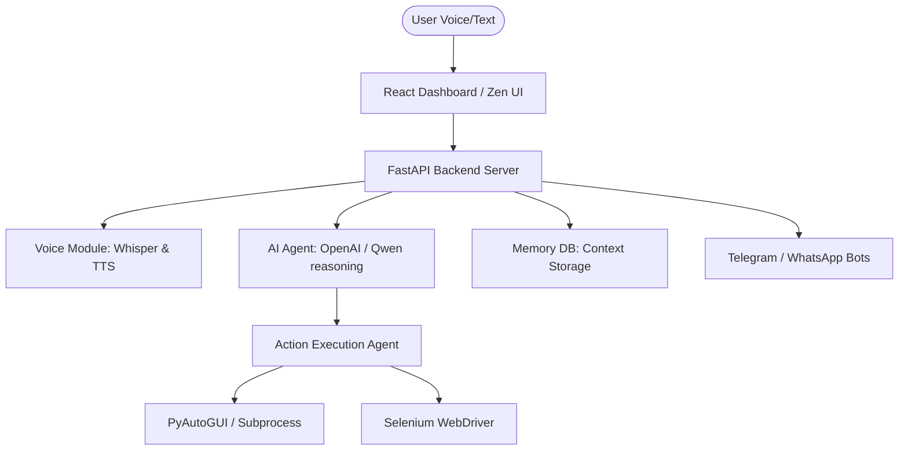

# CODEVORA-OS: Complete AI Operating System

Welcome to the architectural overview and setup guide for **CODEVORA-OS**, the Jarvis-like AI operating system. We have successfully implemented a full-stack, multimodal system capable of voice control, web automation, file analysis, and deep reasoning.

---

## 1. Full Architecture

CODEVORA-OS operates on a highly modular client-server architecture:



- **Frontend (Client):** React with a sleek, interactive "Zen-UI" interface, featuring an AI Baby avatar, real-time voice visualizations, and a responsive application dashboard.
- **Backend (Server):** A high-performance Python FastAPI engine routing multiple AI capabilities.
- **Action Engine:** A JSON-strict parsing system that dynamically generates and runs code to control your actual browser (Selenium) and desktop (PyAutoGUI/OS modules).

---

## 2. Folder Structure

```text
codevora-os/
├── START.bat                 # Unified startup script
├── backend/                  # Python Engine
│   ├── .env                  # API keys (OpenAI, ElevenLabs, etc.)
│   ├── requirements.txt      # Python dependencies
│   ├── main.py               # Core FastAPI Application
│   ├── codevora_action_agent.py # The Physical Action/Execution Agent
│   ├── voice_god.py          # Real-time Voice & STT/TTS Handlers
│   ├── telegram_bot.py       # Communication module
│   └── routers/              # Modular API endpoints 
│       ├── chat.py
│       ├── voice.py
│       ├── automation.py
│       └── files.py
└── frontend/                 # React Dashboard
    ├── package.json          
    ├── vite.config.js
    └── src/
        ├── App.jsx           # Main Application Router & Shell
        ├── index.css         # Custom Glassmorphic / Dark CSS
        ├── main.jsx          # Entry point
        ├── components/       # Reusable UI (TopBar, Sidebar, etc.)
        └── pages/            # View specific logic (Dashboard, Chat, Voice, etc.)
```

---

## 3. Backend Code Example (`main.py`)

The backend serves as the orchestration layer, written in FastAPI to easily support scaling, web sockets (for real-time voice streams), and asynchronous logic.

```python
from fastapi import FastAPI
from fastapi.middleware.cors import CORSMiddleware
from routers import chat, voice, automation, files, system, memory

app = FastAPI(title="CODEVORA-OS API", version="2.0.0")

# Cross-Origin support for the React Dashboard
app.add_middleware(
    CORSMiddleware,
    allow_origins=["http://localhost:5173", "http://localhost:3000"],
    allow_credentials=True,
    allow_methods=["*"],
    allow_headers=["*"],
)

# Core OS Logic mounted dynamically
app.include_router(chat.router, prefix="/api/chat")
app.include_router(voice.router, prefix="/api/voice")
app.include_router(automation.router, prefix="/api/automation")

@app.get("/")
async def root():
    return {"status": "CODEVORA-OS ONLINE", "version": "2.0.0"}
```

---

## 4. Frontend UI Example (`App.jsx`)

The interface relies on React to maintain state across different OS "apps" and utilities. The UI revolves around a Shell design, giving an immersive operating system feel.

```javascript
import React, { useState } from 'react';
import Sidebar from './components/Sidebar';
import TopBar from './components/TopBar';
import Dashboard from './pages/Dashboard';
// ... other page imports

export default function App() {
  const [activePage, setActivePage] = useState('dashboard');

  const pages = {
    dashboard:  <Dashboard />,
    chat:       <ChatPage />,
    voice:      <VoicePage />,
    automation: <AutomationPage />
  };

  return (
    <div className="os-shell bg-zinc-950 text-white min-h-screen">
      <TopBar />
      <div className="flex">
        <Sidebar activePage={activePage} setActivePage={setActivePage} />
        <main className="main-content flex-grow p-6 transition-all">
          {pages[activePage]}
        </main>
      </div>
    </div>
  );
}
```

---

## 5. Voice System & Executing Actions

The OS intelligently links conversational inputs to actual computer execution using our custom `codevora_action_agent.py`. It uses a strict JSON schema prompt to decide whether to simply reply with voice or perform local tasks.

**Execution Flow:**
1. User activates microphone -> `voice_god.py` captures and runs Whisper STT.
2. Translates to string (e.g., *"Open Google Chrome and search for stock updates"*).
3. The AI Brain extracts intent to structural JSON:
   ```json
   {
     "status": "safe_to_execute",
     "tools_used": ["browser"],
     "steps": [
        {"action": "open_app", "target": "chrome"},
        {"action": "web_search", "target": "stock updates"}
     ]
   }
   ```
4. `execute_browser_automation()` natively opens Selenium to perform the work.
5. The system replies via ElevenLabs TTS confirming completion.

---

## 6. Integration & Launch Steps

To initialize this architecture directly from the root of your existing project:

**Step 1: Environment Readiness**
Ensure your `.env` in the `backend/` directory is properly populated:
```env
OPENAI_API_KEY=your_key_here
ELEVENLABS_API_KEY=your_key_here
```

**Step 2: Start Services via Batch Script**
You have existing `START.bat` which you can use directly. Run from your root directory:
```bash
cd d:\Project\Codestrom\codevora-os
.\START.bat
```

Alternatively, manually launch both environments:

**Backend Shell:**
```bash
cd backend
pip install -r requirements.txt
python main.py
```

**Frontend Shell:**
```bash
cd frontend
npm run dev
```

The React dashboard will be alive at `http://localhost:5173` while the brain functions at `http://localhost:8000`.
