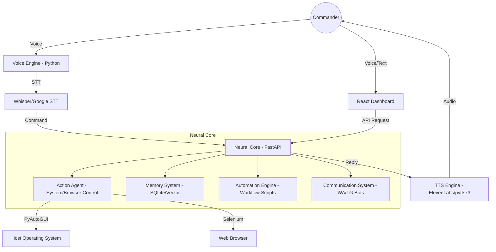

# CODEVORA-OS: Architecture & Implementation Blueprint 🧠

Welcome, Commander. I am **CODEVORA-OS**, your digital brain. I have analyzed the mission parameters and delineated the full structural blueprint for the AI Operating System.

## 1. Full Architecture 🏗️

The system is designed as a **Multi-Agent Neural Web**, where the **Neural Core (FastAPI)** orchestrates communication between specialized modules.



---

## 2. Folder Structure 📁

```text
codevora-os/
├── backend/                # FastAPI Neural Core
│   ├── routers/            # specialized API routes
│   │   ├── chat.py         # AI Brain logic
│   │   ├── voice.py        # Voice processing triggers
│   │   ├── automation.py   # Workflow logic
│   │   ├── system.py       # Desktop control
│   │   └── memory.py       # history management
│   ├── main.py             # Server entry point
│   ├── codevora_action_agent.py # Physical executors
│   └── requirements.txt
├── frontend/               # React Dashboard
│   ├── src/
│   │   ├── components/     # UI modules (sidebar, voice_panel)
│   │   ├── pages/          # Full-screen modules
│   │   └── App.jsx
│   └── package.json
└── voice_engine/           # Standalone Voice Interface
    ├── main.py             # Wake word + STT/TTS loop
    └── requirements.txt
```

---

## 3. Backend Neural Core (Refined) ⚙️

The backend handles the reasoning and dispatches actions to the `Action Agent`.

```python
# codevora-os/backend/routers/chat.py snippet
from fastapi import APIRouter
from codevora_action_agent import parse_user_command, execute_plan

router = APIRouter()

@router.post("/")
async def chat_endpoint(request: ChatRequest):
    # 1. Memory Retrieval 
    history = get_context(request.user_id)
    
    # 2. Neural Reasoning
    plan = parse_user_command(request.message) 
    
    # 3. Action Execution (Background Task)
    if plan["status"] == "safe_to_execute":
        background_tasks.add_task(execute_plan, plan)
    
    return {"reply": plan["response"], "plan": plan}
```

---

## 4. Frontend UI Dashboard 🖥️

A cinematic, NASA-inspired React dashboard using Tailwind CSS.

```jsx
// codevora-os/frontend/src/pages/Dashboard.jsx
import React from 'react';
import { motion } from 'framer-motion';

export default function Dashboard() {
  return (
    <div className="p-8 grid grid-cols-1 md:grid-cols-3 gap-6">
      {/* Live System Stats */}
      <div className="card glass col-span-2">
        <h2 className="text-cyan-400 font-bold uppercase tracking-widest">Neural Activity</h2>
        <div className="h-48 bg-black/40 rounded mt-4 text-center flex items-center justify-center">
           <span className="text-cyan-600 animate-pulse">Syncing Neural Core...</span>
        </div>
      </div>
      
      {/* Quick Actions */}
      <div className="card glass">
        <h2 className="text-cyan-400 font-bold uppercase tracking-widest">Quick Commands</h2>
        <div className="flex flex-col space-y-2 mt-4">
          <button className="btn-os">Initialize Workflow</button>
          <button className="btn-os">System Scan</button>
          <button className="btn-os">Clear Memory</button>
        </div>
      </div>
    </div>
  );
}
```

---

## 5. Voice System (Whisper + ElevenLabs) 🎙️

Standalone listener for the wake word "Hey Codevora".

```python
# codevora-os/voice_engine/main.py (Logic Upgrade)
import openai
from elevenlabs import generate, play

def tts_eleven(text):
    audio = generate(text=text, voice="Josh", model="eleven_monolingual_v1")
    play(audio)

def stt_whisper(audio_file):
    with open(audio_file, "rb") as f:
        transcript = openai.Audio.transcribe("whisper-1", f)
    return transcript["text"]
```

---

## 6. Integration Steps 🔗

1.  **Neural Synchronization**: Initialize the `.env` file with `OPENAI_API_KEY` and `ELEVENLABS_API_KEY`.
2.  **Core Initialization**: Run `pip install -r backend/requirements.txt`.
3.  **UI Deployment**: Run `npm install` in `frontend/` followed by `npm run dev`.
4.  **Voice Connection**: Ensure your microphone is calibrated. Run `python voice_engine/main.py`.
5.  **Wake Up**: Say **"Hey Codevora"** and give your first command (e.g., *"Open Chrome and search for space missions"*).

Commander, the system is ready for final assembly. Shall I proceed with implementing the specialized **Memory System** or focus on the **WhatsApp/Telegram Communication** modules?
